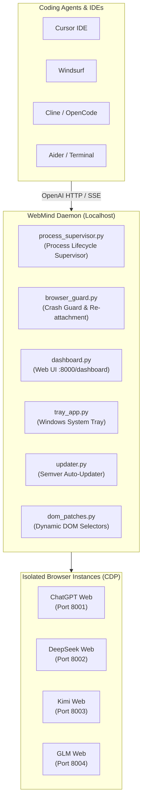

<div align="center">

# WebMind 🧠⚡

**Production-Grade Local AI Bridge Connecting Web LLMs Directly to Coding Agents**

[](https://opensource.org/licenses/MIT)
[](https://github.com/Vaibhav-Upadhyaya-codes/WebMind/releases)
[](https://www.python.org/)
[](https://microsoft.com/windows)
[]()

*Turn your ChatGPT Plus/Free, DeepSeek, Kimi, and GLM web accounts into unlimited, local OpenAI-compatible API endpoints for Cursor, Windsurf, Cline, OpenCode, Continue.dev, and Aider.*

---

</div>

## 🌟 Key Highlights

- **Zero API Costs**: Leverage your existing web browser AI subscriptions without paying per-token API charges.
- **Universal Multi-AI Engine**: Connect simultaneously to **ChatGPT**, **DeepSeek**, **Kimi**, and **GLM**.
- **Web Control Panel (`:8000/dashboard`)**: Modern real-time dashboard displaying server health, request throughput, latency, and browser sessions.
- **Windows System Tray App**: Silent background daemon with one-click access to the dashboard and quick server toggles.
- **Self-Healing & Crash Guard**: Automatically detects accidental browser closures or network drops and re-attaches seamlessly without losing in-flight requests.
- **Zero Profile Conflict**: Runs in completely isolated browser user-data directories (`WebMindChrome`, `WebMindEdge`, `WebMindBrave`) so your personal browser remains 100% free.
- **Dynamic DOM Hot-Patching**: Front-end selector shifts on AI websites can be updated dynamically without re-installing or downloading new binaries.
- **100% Localhost & Private**: Zero cloud telemetry, no analytics, and built-in credential sanitization.

---

## 🚀 Quick Install (Windows)

### Option 1: 1-Line PowerShell Install (Recommended)

Open PowerShell and paste:

```powershell
irm https://raw.githubusercontent.com/Vaibhav-Upadhyaya-codes/WebMind/master/install.ps1 | iex
```

This automatically downloads the latest release, extracts WebMind to `%LOCALAPPDATA%\Programs\WebMind`, creates Desktop & Start Menu shortcuts, and launches the Web Control Panel.

### Option 2: Portable Download

1. Download [`WebMind-v1.0.0-Windows-Portable.zip`](https://github.com/Vaibhav-Upadhyaya-codes/WebMind/releases/latest) from the [Releases page](https://github.com/Vaibhav-Upadhyaya-codes/WebMind/releases).
2. Extract anywhere and double-click `WebMind.bat`.

### Option 3: Developer Setup (From Source)

```powershell
# Clone repository
git clone https://github.com/Vaibhav-Upadhyaya-codes/WebMind.git
cd WebMind

# Install dependencies
python -m pip install -r requirements.txt

# Launch interactive manager
python launcher.py
```

---

## 🖥️ Web Control Panel (`:8000/dashboard`)

Once launched, visit **`http://localhost:8000/dashboard`** to manage all your AI services:

```text
┌────────────────────────────────────────────────────────────────────────┐
│  WebMind Dashboard v1.0.0          [Check Updates]  [System Tray: ON]   │
├────────────────────────────────────────────────────────────────────────┤
│  Providers Overview:                                                   │
│  ● ChatGPT   [Online]   Port: 8001   Latency: 42ms   [Restart] [Open]  │
│  ● DeepSeek  [Online]   Port: 8002   Latency: 38ms   [Restart] [Open]  │
│  ● Kimi      [Online]   Port: 8003   Latency: 45ms   [Restart] [Open]  │
│  ● GLM       [Online]   Port: 8004   Latency: 50ms   [Restart] [Open]  │
├────────────────────────────────────────────────────────────────────────┤
│  1-Click Coding Agent Setup:                                           │
│  [Cursor]   [Windsurf]   [Cline]   [OpenCode]   [Continue.dev]         │
└────────────────────────────────────────────────────────────────────────┘
```

- **Live Service Toggles**: Start or stop individual browser engines.
- **Browser Window Opener**: Open the isolated browser with one click to log in.
- **Manual Port Customization**: Switch between shared mode (all providers on `:8001`) or discrete ports (`:8001` to `:8004`).
- **1-Click Diagnostics Export**: Export sanitized rotating logs directly into a zip bundle for troubleshooting.

---

## 🤖 Coding Agent & Harness Integration

WebMind exposes standard OpenAI-compatible endpoints with full streaming (SSE), JSON mode, and tool-call support.

### Complete Model ID & Endpoint Reference

| Provider | Operating Mode | Exact Base URL / Endpoint | Exact Model ID / Name |
|---|---|---|---|
| **DeepSeek** | **Discrete (Recommended)** | `http://127.0.0.1:8002/v1` | `deepseek-chat`, `deepseek-coder`, `deepseek-r1`, `webmind` |
| **ChatGPT** | **Discrete (Recommended)** | `http://127.0.0.1:8001/v1` | `chatgpt`, `webmind`, `gpt-4o` |
| **Kimi** | **Discrete** | `http://127.0.0.1:8003/v1` | `kimi`, `moonshot-v1-8k`, `webmind` |
| **GLM-4** | **Discrete** | `http://127.0.0.1:8004/v1` | `glm-4`, `glm`, `webmind` |
| **All Providers** | **Shared Mode** | `http://127.0.0.1:8001/v1` | `deepseek`, `chatgpt`, `kimi`, `glm`, `webmind` |

> [!NOTE]
> For all clients, set **API Key** to `sk-webmind` (or any string when API key auth is disabled).

---

### 1. OpenCode Configuration

OpenCode supports WebMind directly via its `opencode.json` configuration file.

#### File Location:
- Windows: `%USERPROFILE%\.config\opencode\opencode.json` or project root `opencode.json`
- Linux / macOS: `~/.config/opencode/opencode.json`

#### Config Example (`opencode.json`):
```json
{
  "$schema": "https://opencode.ai/config.json",
  "models": {
    "webmind-deepseek": {
      "type": "openai",
      "name": "WebMind (DeepSeek Web)",
      "baseUrl": "http://127.0.0.1:8002/v1",
      "apiKey": "sk-webmind",
      "model": "deepseek-chat"
    },
    "webmind-chatgpt": {
      "type": "openai",
      "name": "WebMind (ChatGPT Web)",
      "baseUrl": "http://127.0.0.1:8001/v1",
      "apiKey": "sk-webmind",
      "model": "webmind"
    }
  }
}
```

#### Run OpenCode with WebMind:
```powershell
opencode -m webmind-deepseek
```

---

### 2. DeepSeek Harness & Automated Agent Runners

WebMind was built with strict conformance for DeepSeek test harnesses (e.g. `dsh-llm-deepseek`, SWE-bench runners, and custom evaluation harnesses). It parses tool-calling envelopes, repairs Windows backslash escapes, and produces standardized OpenAI error payloads (`{"error": {"message": ..., "type": ..., "code": ...}}`).

#### Python Harness Example (`openai` SDK):
```python
from openai import OpenAI

# Connect to WebMind DeepSeek endpoint
client = OpenAI(
    base_url="http://127.0.0.1:8002/v1",  # Port 8002 for Discrete, 8001 for Shared
    api_key="sk-webmind",
)

response = client.chat.completions.create(
    model="deepseek-chat",  # Exact Model IDs: "deepseek-chat", "deepseek-coder", "deepseek-r1"
    messages=[
        {"role": "system", "content": "You are an expert coding assistant."},
        {"role": "user", "content": "Write a python function to compute SHA-256."},
    ],
    temperature=0.2,
    stream=False,  # Full SSE streaming also supported with stream=True
)

print(response.choices[0].message.content)
```

#### Terminal / cURL Harness Verification:
```powershell
curl.exe -X POST http://127.0.0.1:8002/v1/chat/completions `
  -H "Content-Type: application/json" `
  -H "Authorization: Bearer sk-webmind" `
  -d '{
    "model": "deepseek-chat",
    "messages": [{"role": "user", "content": "Reply with: WebMind DeepSeek is connected."}]
  }'
```

---

### 3. Cursor & Windsurf IDE Setup

#### Connecting to Cursor
1. Go to **Cursor Settings** -> **Models**.
2. Turn off default models and click **Add Custom Model**.
3. Add Model ID: `deepseek-chat` (or `webmind`).
4. Under **OpenAI API Key**:
   - Check **Override OpenAI Base URL**: `http://127.0.0.1:8002/v1` (or `:8001/v1` for shared).
   - Enter API Key: `sk-webmind`.

#### Connecting to Windsurf
Add to `~/.codeium/windsurf/memories/global_rules.md` or client config:
```json
{
  "model_provider": "openai",
  "base_url": "http://127.0.0.1:8002/v1",
  "api_key": "sk-webmind",
  "model_name": "deepseek-chat"
}
```

#### Connecting to Cline / Roo Code / Continue.dev
1. Provider: **OpenAI Compatible**
2. Base URL: `http://127.0.0.1:8002/v1` (DeepSeek) or `http://127.0.0.1:8001/v1` (ChatGPT / Shared)
3. API Key: `sk-webmind`
4. Model ID: `deepseek-chat` or `webmind`

---

## 🏗️ Architecture



---

## 🧪 Testing & Reliability

WebMind includes a test suite covering conformance, tool calling, deduplication, error recovery, and auto-update staging:

```powershell
python -m unittest discover
```
```text
Ran 413 tests in 22.369s
OK
```

---

## 🔒 Security & Privacy

- **Localhost Exclusive**: By default, all WebMind servers bind strictly to `127.0.0.1`.
- **Bearer Token Auth**: Optional API key authentication can be enabled via the dashboard (`api_key_required: true`).
- **Log Sanitization**: High-entropy strings, passwords, and API tokens (`sk-...`) are scrubbed before writing to logs.
- **Zero Third-Party Relays**: Direct communication between your IDE and your local browser session.

---

## 📜 License

MIT License. See [LICENSE](LICENSE) for details.
