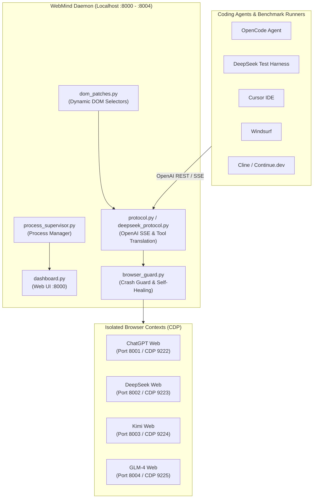

<div align="center">

# WebMind 🧠⚡

**Production-Grade Local AI Bridge Connecting Web LLMs Directly to Coding Agents & Evaluation Harnesses**

[](https://opensource.org/licenses/MIT)
[](https://github.com/Vaibhav-Upadhyaya/WebMind/releases)
[](https://www.python.org/)
[](https://microsoft.com/windows)
[]()
[]()

*Turn your web accounts (**DeepSeek, ChatGPT Plus/Free, Kimi, GLM-4**) into unlimited, local OpenAI-compatible API endpoints for **OpenCode, DeepSeek Harness, Cursor, Windsurf, Cline, Continue.dev, and Aider**.*

---

</div>

## 📑 Table of Contents

- [🌟 Why WebMind?](#-why-webmind)
- [🔌 Default Ports & Service Topology](#-default-ports--service-topology)
- [📡 OpenAI Completion Protocol Specification](#-openai-completion-protocol-specification)
- [⚡ Wiring WebMind to OpenCode](#-wiring-webmind-to-opencode)
- [🔬 Wiring to DeepSeek Harness & Benchmark Runners](#-wiring-to-deepseek-harness--benchmark-runners)
- [💻 Connecting Other IDEs & Coding Agents](#-connecting-other-ides--coding-agents)
  - [Cursor IDE](#cursor-ide)
  - [Windsurf IDE](#windsurf-ide)
  - [Cline & Roo Code](#cline--roo-code)
  - [Continue.dev](#continuedev)
  - [Aider](#aider)
- [🚀 Quick Installation & Setup](#-quick-installation--setup)
- [🖥️ Web Control Panel (`:8000/dashboard`) & System Tray](#️-web-control-panel-8000dashboard--system-tray)
- [🩹 Dynamic DOM Hot-Patching](#-dynamic-dom-hot-patching)
- [🏗️ System Architecture](#️-system-architecture)
- [🧪 Test Suite & Reliability](#-test-suite--reliability)
- [🔒 Security & Privacy](#-security--privacy)
- [📜 License](#-license)

---

## 🌟 Why WebMind?

Every developer running autonomous coding agents hits the exact same wall: **per-token API bills accumulate rapidly** when an agent inspects files, runs tests, and refactors repositories.

Meanwhile, your browser accounts on **DeepSeek, ChatGPT, Kimi, and GLM** offer massive context windows and generous usage tiers that cannot natively talk to developer tools.

**WebMind bridges this gap:**
- **Zero API Costs**: Powers your coding agents using your existing authenticated browser sessions.
- **Universal OpenAI Protocol**: Exposes standard `/v1/chat/completions` endpoints supporting full Server-Sent Events (SSE) streaming and tool calling.
- **Zero Profile Collisions**: Uses dedicated, isolated browser data directories (`WebMindChrome`, `WebMindEdge`, `WebMindBrave`). Your personal browser, extensions, and daily tabs are 100% unaffected.
- **Self-Healing & Crash Guard**: If a browser tab or window drops, WebMind automatically detects the disconnection, restarts the CDP process, re-attaches, and retries in-flight requests without failing the client.
- **Auto-Escape & Windows Path Repair**: Sanitizes Windows file paths (`C:\Users\...`) and repairs model JSON formatting so agent tool calls never crash during evaluation loops.

---

## 🔌 Default Ports & Service Topology

WebMind supports two operating modes: **Discrete Mode** (dedicated ports per provider, recommended for multi-agent workflows) and **Shared Mode** (unified port with dynamic model routing).

### Complete Default Port Matrix

| Service / Provider | Mode | Default Port | Base URL (`/v1`) | Chrome CDP Port | Model Identifiers |
|---|---|---|---|---|---|
| **Web Dashboard** | Web UI | **`8000`** | `http://localhost:8000/dashboard` | N/A | Management Console |
| **DeepSeek** | **Discrete** | **`8002`** | `http://127.0.0.1:8002/v1` | `9223` | `deepseek-chat`, `deepseek-coder`, `deepseek-r1`, `webmind` |
| **ChatGPT** | **Discrete** | **`8001`** | `http://127.0.0.1:8001/v1` | `9222` | `chatgpt`, `gpt-4o`, `webmind` |
| **Kimi** | **Discrete** | **`8003`** | `http://127.0.0.1:8003/v1` | `9224` | `kimi`, `moonshot-v1-8k`, `webmind` |
| **GLM-4** | **Discrete** | **`8004`** | `http://127.0.0.1:8004/v1` | `9225` | `glm-4`, `glm`, `webmind` |
| **Unified Proxy** | **Shared** | **`8001`** | `http://127.0.0.1:8001/v1` | Dynamic | All models via `model` request field |

> [!TIP]
> **API Key Convention**: For all endpoints, set `Authorization: Bearer sk-webmind` (or any non-empty string when API key auth is disabled).

---

## 📡 OpenAI Completion Protocol Specification

WebMind implements the official OpenAI Chat Completions REST contract, allowing drop-in compatibility with the official `openai` SDK, LangChain, LlamaIndex, LiteLLM, and autonomous coding agents.

### Supported Endpoints

- `POST /v1/chat/completions` — Standard Chat Completions (streaming and non-streaming)
- `GET /v1/models` — Lists registered model identifiers
- `GET /health` — Health check endpoint reporting active provider statuses and latencies

### 1. Request Structure (`POST /v1/chat/completions`)

```json
{
  "model": "deepseek-chat",
  "messages": [
    {"role": "system", "content": "You are a senior software engineer."},
    {"role": "user", "content": "Inspect the repository and list existing unit tests."}
  ],
  "stream": true,
  "temperature": 0.2,
  "tools": [
    {
      "type": "function",
      "function": {
        "name": "bash",
        "description": "Execute shell commands in the workspace",
        "parameters": {
          "type": "object",
          "properties": {
            "command": {"type": "string", "description": "The command to run"}
          },
          "required": ["command"]
        }
      }
    }
  ]
}
```

### 2. Streaming Contract (Server-Sent Events)

When `stream: true`, WebMind streams incremental chunks as the web browser renders responses:

```text
data: {"id":"chatcmpl-a1b2c3","object":"chat.completion.chunk","created":1730240000,"model":"deepseek-chat","choices":[{"index":0,"delta":{"content":"Let"},"finish_reason":null}]}

data: {"id":"chatcmpl-a1b2c3","object":"chat.completion.chunk","created":1730240000,"model":"deepseek-chat","choices":[{"index":0,"delta":{"content":" me inspect"},"finish_reason":null}]}

data: [DONE]
```

### 3. Tool-Calling Translation Engine

WebMind translates OpenAI function definitions into grounded browser directives and extracts structured tool calls from model output:

```json
{
  "id": "chatcmpl-t12345",
  "object": "chat.completion",
  "created": 1730240000,
  "model": "deepseek-chat",
  "choices": [
    {
      "index": 0,
      "message": {
        "role": "assistant",
        "content": null,
        "tool_calls": [
          {
            "id": "call_bash_01",
            "type": "function",
            "function": {
              "name": "bash",
              "arguments": "{\"command\": \"git status\"}"
            }
          }
        ]
      },
      "finish_reason": "tool_calls"
    }
  ]
}
```

---

## ⚡ Wiring WebMind to OpenCode

OpenCode supports WebMind directly via its `opencode.json` configuration file. You can configure it **automatically in 1 click** or **manually**.

### Option A: 1-Click Auto Configuration (Recommended)

Run the interactive launcher and press `C`:

```powershell
python launcher.py
# Press 'C' -> Auto-Configure OpenCode
```

Or run directly from Python:
```powershell
python -c "import agent_config; print(agent_config.write_opencode_config())"
```

### Option B: Manual Configuration

Open or create your OpenCode configuration file:
- **Windows**: `%USERPROFILE%\.config\opencode\opencode.json` (or root `opencode.json` in your workspace)
- **macOS / Linux**: `~/.config/opencode/opencode.json`

Add the WebMind provider and model definitions:

```json
{
  "$schema": "https://opencode.ai/config.json",
  "provider": {
    "webmind-deepseek": {
      "name": "WebMind",
      "npm": "@ai-sdk/openai-compatible",
      "options": {
        "baseURL": "http://127.0.0.1:8002/v1",
        "apiKey": "sk-webmind"
      },
      "models": {
        "deepseek": {
          "name": "DeepSeek"
        }
      }
    },
    "webmind-chatgpt": {
      "name": "WebMind",
      "npm": "@ai-sdk/openai-compatible",
      "options": {
        "baseURL": "http://127.0.0.1:8001/v1",
        "apiKey": "sk-webmind"
      },
      "models": {
        "chatgpt": {
          "name": "ChatGPT"
        }
      }
    }
  },
  "models": {
    "webmind-deepseek": {
      "type": "openai",
      "name": "DeepSeek",
      "provider": "WebMind",
      "baseUrl": "http://127.0.0.1:8002/v1",
      "apiKey": "sk-webmind",
      "model": "deepseek-chat"
    },
    "webmind-chatgpt": {
      "type": "openai",
      "name": "ChatGPT",
      "provider": "WebMind",
      "baseUrl": "http://127.0.0.1:8001/v1",
      "apiKey": "sk-webmind",
      "model": "webmind"
    }
  }
}
```

### Launching OpenCode with WebMind

Start OpenCode targeting your local DeepSeek or ChatGPT pipeline:

```powershell
# Run with DeepSeek (Port 8002)
opencode -m webmind-deepseek

# Run with ChatGPT (Port 8001)
opencode -m webmind-chatgpt
```

---

## 🔬 Wiring to DeepSeek Harness & Benchmark Runners

WebMind was built with strict conformance for DeepSeek test harnesses (e.g. `dsh-llm-deepseek`, SWE-bench harnesses, and autonomous evaluation scripts).

### Why WebMind Works with DeepSeek Harnesses
1. **Windows Path Sanitization**: Harnesses executing on Windows often send or receive unescaped backslashes (`C:\workspace\file.py`). WebMind automatically normalizes unescaped escape sequences in JSON envelopes so tests never crash with `JSONDecodeError`.
2. **Idempotency Guard**: Harnesses executing retries are protected by WebMind's request deduplication cache (`_request_guard`), preventing re-submission collisions.
3. **Tail-Anchored History**: Long continuation prompts anchor context at the most recent tool interactions so critical file reads are never dropped when turns grow large.

### 1. Python OpenAI SDK Integration

```python
from openai import OpenAI

# Connect to WebMind's DeepSeek endpoint on Port 8002
client = OpenAI(
    base_url="http://127.0.0.1:8002/v1",
    api_key="sk-webmind",
)

# 1. Non-Streaming Request
response = client.chat.completions.create(
    model="deepseek-chat",
    messages=[
        {"role": "system", "content": "You are an autonomous coding assistant."},
        {"role": "user", "content": "List the files in the workspace and fix issues in tests."},
    ],
    temperature=0.0,
    stream=False,
)
print("Assistant Response:", response.choices[0].message.content)

# 2. Streaming Request
stream = client.chat.completions.create(
    model="deepseek-chat",
    messages=[{"role": "user", "content": "Explain the architecture of WebMind."}],
    stream=True,
)
for chunk in stream:
    delta = chunk.choices[0].delta.content or ""
    print(delta, end="", flush=True)
```

### 2. cURL / Terminal Verification

```powershell
curl.exe -X POST http://127.0.0.1:8002/v1/chat/completions `
  -H "Content-Type: application/json" `
  -H "Authorization: Bearer sk-webmind" `
  -d '{
    "model": "deepseek-chat",
    "messages": [{"role": "user", "content": "Hello DeepSeek, confirm WebMind is live."}]
  }'
```

---

## 💻 Connecting Other IDEs & Coding Agents

### Cursor IDE
1. Open **Cursor Settings** -> **Models**.
2. Under **OpenAI API Key**:
   - Check **Override OpenAI Base URL**: `http://127.0.0.1:8002/v1` (for DeepSeek) or `http://127.0.0.1:8001/v1` (for ChatGPT).
   - Enter API Key: `sk-webmind`.
3. Add Custom Model: `deepseek-chat` or `webmind`.

### Windsurf IDE
Add to your Windsurf configuration (`~/.codeium/windsurf/memories/global_rules.md` or client settings):
```json
{
  "model_provider": "openai",
  "base_url": "http://127.0.0.1:8002/v1",
  "api_key": "sk-webmind",
  "model_name": "deepseek-chat"
}
```

### Cline & Roo Code
1. In the VS Code extension settings, select API Provider: **OpenAI Compatible**.
2. Base URL: `http://127.0.0.1:8002/v1` (DeepSeek) or `http://127.0.0.1:8001/v1` (ChatGPT).
3. API Key: `sk-webmind`.
4. Model ID: `deepseek-chat` or `webmind`.

### Continue.dev
In `~/.continue/config.json`:
```json
{
  "models": [
    {
      "title": "WebMind DeepSeek",
      "provider": "openai",
      "model": "deepseek-chat",
      "apiBase": "http://127.0.0.1:8002/v1",
      "apiKey": "sk-webmind"
    }
  ]
}
```

### Aider
```powershell
aider --openai-api-base http://127.0.0.1:8002/v1 --openai-api-key sk-webmind --model openai/deepseek-chat
```

---

## 🚀 Quick Installation & Setup

### Option 1: 1-Line PowerShell Install (Windows)

Open PowerShell and run:

```powershell
irm https://raw.githubusercontent.com/Vaibhav-Upadhyaya/WebMind/main/install.ps1 | iex
```

This installs WebMind to `%LOCALAPPDATA%\Programs\WebMind`, creates Start Menu & Desktop shortcuts, installs dependencies, and launches the dashboard.

### Option 2: Portable Download

1. Download the latest [`WebMind-v1.0.1-Windows-Portable.zip`](https://github.com/Vaibhav-Upadhyaya/WebMind/releases/latest).
2. Extract anywhere on your PC and double-click `WebMind.bat`.

### Option 3: Developer Setup (From Source)

```powershell
# 1. Clone repository
git clone https://github.com/Vaibhav-Upadhyaya/WebMind.git
cd WebMind

# 2. Install requirements
python -m pip install -r requirements.txt

# 3. Launch interactive manager
python launcher.py
```

### First-Time Login Walkthrough
1. When a provider is launched for the first time, WebMind opens an isolated browser window.
2. Log into your account (e.g., DeepSeek, ChatGPT, Kimi, GLM).
3. Your session is saved persistently in `%LOCALAPPDATA%\WebMind\profiles\`. You only ever log in **once**.

---

## 🖥️ Web Control Panel (`:8000/dashboard`) & System Tray

Launch the dashboard at **`http://localhost:8000/dashboard`**:

```text
┌────────────────────────────────────────────────────────────────────────┐
│  WebMind Dashboard v1.0.1          [Check Updates]  [System Tray: ON]   │
├────────────────────────────────────────────────────────────────────────┤
│  Providers Overview:                                                   │
│  ● DeepSeek  [Online]   Port: 8002   Latency: 38ms   [Restart] [Open]  │
│  ● ChatGPT   [Online]   Port: 8001   Latency: 42ms   [Restart] [Open]  │
│  ● Kimi      [Online]   Port: 8003   Latency: 45ms   [Restart] [Open]  │
│  ● GLM       [Online]   Port: 8004   Latency: 50ms   [Restart] [Open]  │
├────────────────────────────────────────────────────────────────────────┤
│  1-Click Coding Agent Setup:                                           │
│  [OpenCode]   [Cursor]   [Windsurf]   [Cline]   [Continue.dev]         │
└────────────────────────────────────────────────────────────────────────┘
```

- **Service Controls**: Start, stop, or restart individual model servers.
- **Browser Window Opener**: Open any isolated profile with one click to log in or inspect sessions.
- **Port Switching**: Toggle between Discrete Mode (`8001-8004`) and Shared Mode (`8001`).
- **1-Click Diagnostics**: Export sanitized rotating log bundles to `.zip` for instant troubleshooting.

---

## 🩹 Dynamic DOM Hot-Patching

When web AI providers modify their front-end web markup (e.g., changing send button classes, input textarea IDs, or container elements), WebMind's **Dynamic DOM Hot-Patching Engine** allows updating selector cascades on the fly without downloading new binaries or reinstalling packages.

- Selector patches are persisted in `%LOCALAPPDATA%\WebMind\patches.json`.
- Built-in selectors serve as automatic fallbacks.
- Manage patches via the dashboard or Python:
  ```python
  from dom_patches import apply_patch
  apply_patch("deepseek", "input", ["textarea#custom-chat-input"])
  ```

---

## 🏗️ System Architecture



---

## 🧪 Test Suite & Reliability

WebMind includes a rigorous test suite of **413 automated unit tests** covering protocol conformance, tool-call validation, streaming stability, and multi-browser resilience:

```powershell
python -m unittest discover
```
```text
Ran 413 tests in 22.369s

OK
```

---

## 🔒 Security & Privacy

- **Strict Localhost Binding**: All servers bind exclusively to `127.0.0.1`.
- **Zero Third-Party Relays**: Direct communication between your IDE and your local browser session.
- **Log Sanitization**: Passwords, auth cookies, and high-entropy API tokens are automatically redacted before writing to log files.
- **Isolated User Profiles**: Never accesses or modifies your everyday personal Chrome/Edge browser data.

---

## 📜 License

Distributed under the **MIT License**. See [`LICENSE`](LICENSE) for complete terms.
